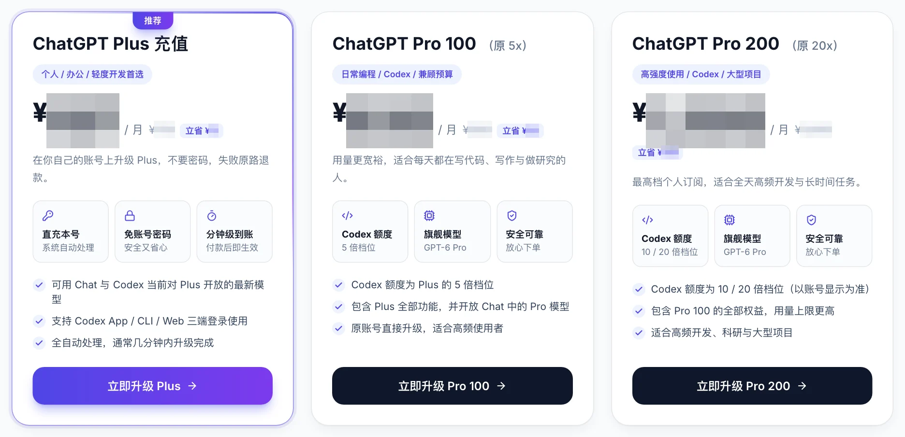
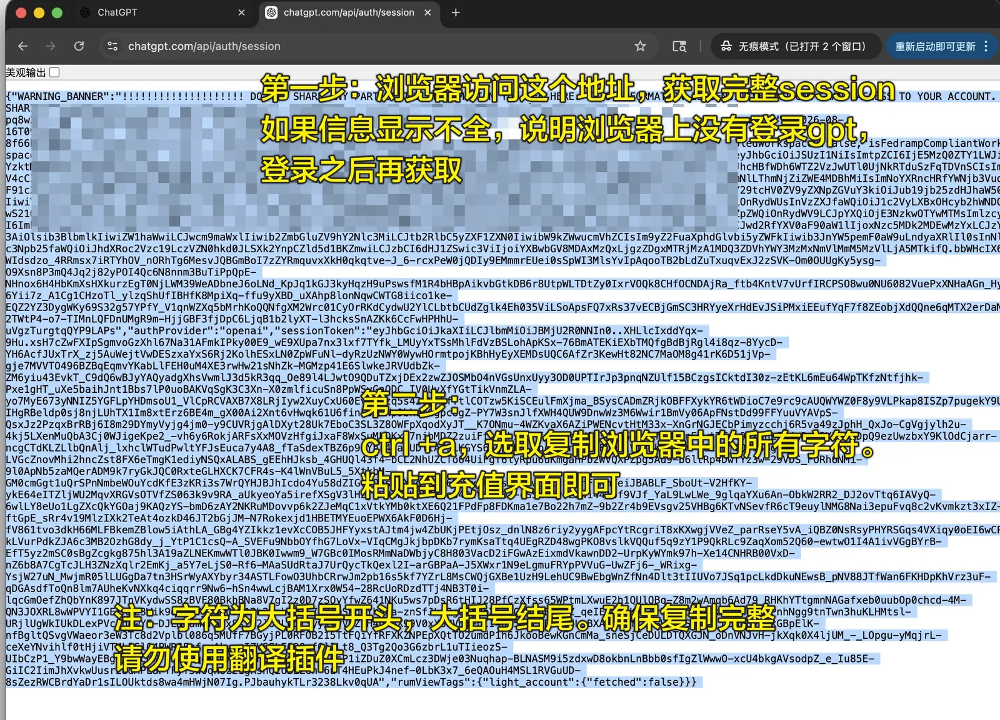
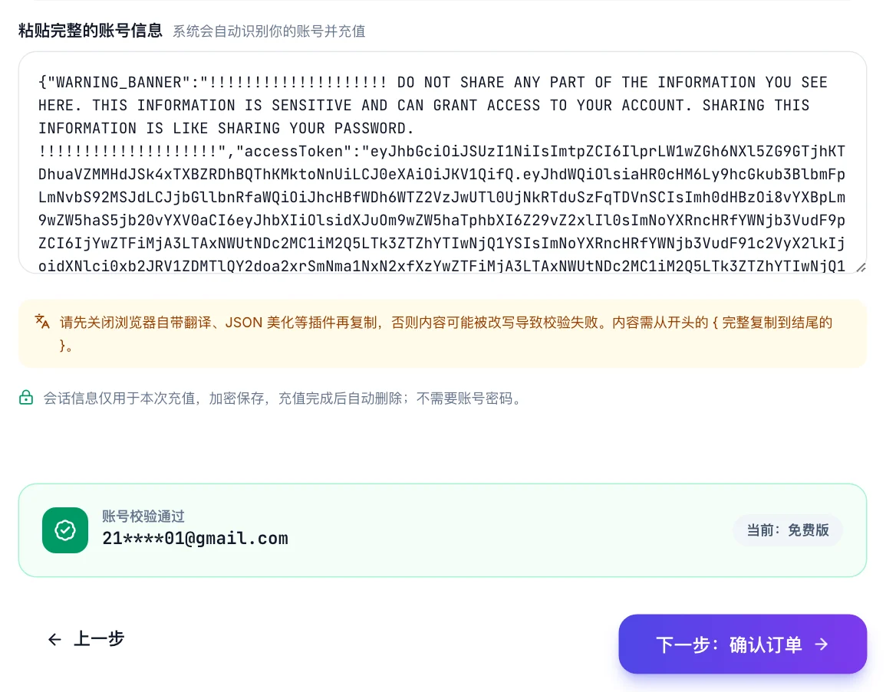
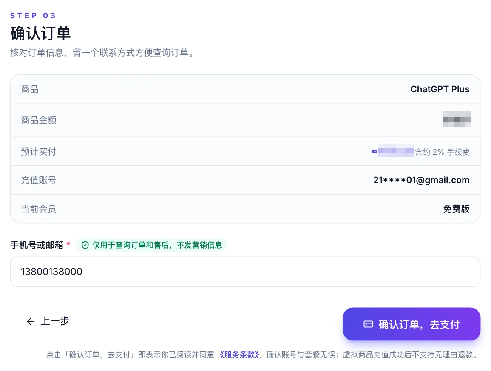
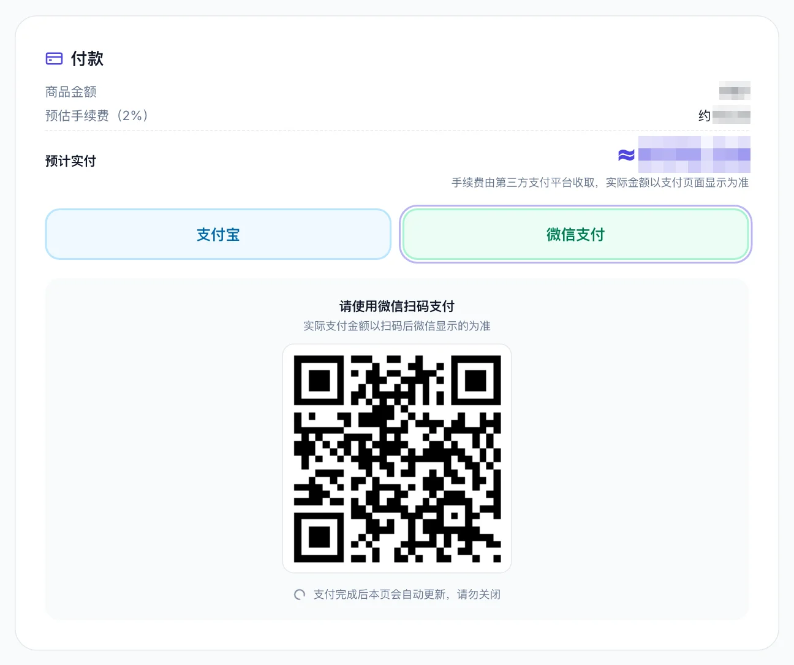
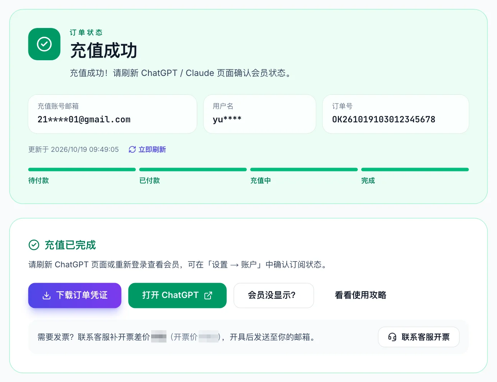
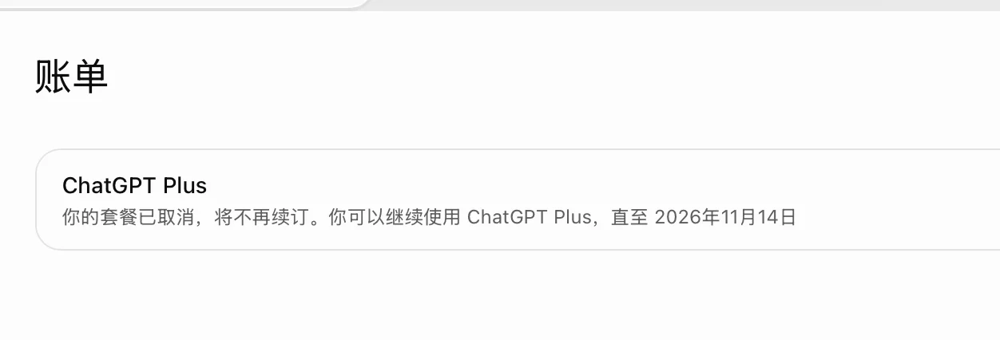

# ChatGPT 充值入口与教程 2026：Plus / Pro 支付宝微信 4 步开通，Go、Plus、Pro 各档区别

> 最后更新：2026 年 11 月 11 日 · 人民币价格按当天 OKAI66 套餐页核对；套餐权益按当天 OpenAI 官方定价页与帮助中心核对，出处列在文末。发现过期内容欢迎提 Issue。

**👉 [ChatGPT 充值入口：支付宝 / 微信开通 Plus / Pro，okai66.com](https://okai66.com/?utm_source=github&utm_medium=readme&utm_campaign=recharge-top)**

没时间看全文，先看这 5 条：

- **充值入口**：[okai66.com 套餐页](https://okai66.com/plus-price?utm_source=github&utm_medium=readme&utm_campaign=recharge-quick)，支付宝、微信都能付。
- **怎么充**：选套餐 → 粘贴账号会话信息并校验 → 付款 → 自动到账，一共 4 步，付款后通常几分钟完成。
- **多少钱**：Plus ¥165 / 月，Pro 100 ¥830 / 月，Pro 200 ¥1,500 / 月，Pro 500 ¥4,000 / 月（2026 年 11 月 11 日套餐页价格）。
- **充到哪**：充到你自己的 ChatGPT 账号上，不要密码、不换号，聊天记录都在。
- **之后呢**：不会自动续费，到期后要用再充；没充成功原路退款。

## 目录

- [ChatGPT 充值 4 步流程（支付宝 / 微信，附截图）](#chatgpt-充值-4-步流程支付宝--微信附截图)
- [ChatGPT 充值价格：Plus、Pro 各档人民币多少钱](#chatgpt-充值价格pluspro-各档人民币多少钱)
- [ChatGPT Free、Go、Plus、Pro 区别（按官方定价页）](#chatgpt-freegopluspro-区别按官方定价页)
- [Plus 和 Pro 怎么选](#plus-和-pro-怎么选)
- [充值前先确认这 5 件事](#充值前先确认这-5-件事)
- [充值常见问题与解决办法](#充值常见问题与解决办法)
- [在官网自己付款时的常见报错](#在官网自己付款时的常见报错)
- [常见问题 FAQ](#常见问题-faq)
- [资料来源](#资料来源)

## ChatGPT 充值 4 步流程（支付宝 / 微信，附截图）

OpenAI 官方定价页写的付款方式是信用卡，帮助中心列出的各地区本地付款方式里没有支付宝和微信，支持的国家 / 地区列表里也没有中国大陆。所以国内用支付宝、微信充值，走的都是第三方平台。下面是在 [OKAI66](https://okai66.com/?utm_source=github&utm_medium=readme&utm_campaign=recharge-steps-intro) 上的实际流程，Plus 和 Pro 各档操作完全一样。

截图是 2026 年 10 月的界面，价格做了遮盖；现在套餐页多了 Pro 500 一档，其余步骤没变。

### 第 1 步：选择套餐

打开 [套餐页](https://okai66.com/plus-price?utm_source=github&utm_medium=readme&utm_campaign=recharge-step1)，选 Plus、Pro 100、Pro 200 或 Pro 500，点「立即升级」进入下单页。

同一个账号只下一单。重复充值会互相覆盖，时长不会叠加。

### 第 2 步：复制会话信息并校验账号

充值系统要知道给哪个账号充，但不需要你的密码，用的是账号的「会话信息」。

1. 在浏览器里登录要充值的 ChatGPT 账号。
2. 在**同一个浏览器**里打开 `https://chatgpt.com/api/auth/session`，页面会显示一段以 `{` 开头、以 `}` 结尾的文本。
3. 按 Ctrl+A（Mac 是 Cmd+A）全选后复制。不要手动拖选，容易漏掉首尾字符。

回到下单页粘贴，点「校验账号」。校验通过后页面会显示这个账号的邮箱、用户名和当前套餐，对一下是不是你要充的那个号。

如果账号已经是 Plus 或 Pro，页面会要求勾选「确认覆盖」。新套餐会替换原会员，原来剩下的天数不会叠加，离到期还很久的话建议到期后再充。

### 第 3 步：确认订单，支付宝或微信付款

填一个常用手机号或邮箱（只用来以后查订单），确认订单。

进入订单页后选支付宝或微信。电脑上是扫码，手机上会直接跳到支付宝或微信 App。

支付通道手续费由买家承担，实付金额以支付页面显示为准。未付款的订单 30 分钟后会自动关闭。

### 第 4 步：等自动到账，回 ChatGPT 核对

付款后系统自动充值，订单页会依次显示「已付款 → 充值中 → 完成」。

完成后回到 ChatGPT 刷新页面，没变化就退出重新登录，在设置的账户 / 账单页确认已经显示对应套餐。

**👉 [照着上面 4 步，现在去充值，okai66.com](https://okai66.com/?utm_source=github&utm_medium=readme&utm_campaign=recharge-steps)**

## ChatGPT 充值价格：Plus、Pro 各档人民币多少钱

| 套餐 | OKAI66 充值价（2026-11-11） | OpenAI 官方月费 | 适合谁 |
|---|---|---|---|
| **Plus** | **¥165 / 月** | $20 | 日常写作、学习、办公、轻度写代码 |
| **Pro 100** | **¥830 / 月** | $100 | 每天用 Codex，Plus 额度经常不够 |
| **Pro 200** | **¥1,500 / 月** | $200 | 高强度开发、长任务、大项目 |
| **Pro 500** | **¥4,000 / 月** | $500 | 多项目并行，需要超快模式 |

- 人民币价格会随汇率和渠道成本调整，下单前以 [套餐页](https://okai66.com/plus-price?utm_source=github&utm_medium=readme&utm_campaign=recharge-price) 实时显示为准。
- 在线付款另有支付通道手续费，金额在支付页面单独显示。
- OKAI66 套餐页目前只有 Plus 和 Pro 三档，没有 Go。
- 官方美元价来自 OpenAI 帮助中心；官方定价页会按你所在地区显示当地货币，看到的数字可能不是美元。

## ChatGPT Free、Go、Plus、Pro 区别（按官方定价页）

下表每一格都摘自 OpenAI 官方定价页（2026 年 11 月 11 日中文版），没有加自己的推测。

| 对比项 | Free 免费版 | Go | Plus | Pro |
|---|---|---|---|---|
| 官方定位 | 日常任务的智能解决方案 | 扩展访问权限 | 以更先进的智能完成更多工作 | 大幅提升工作效率 |
| 模型 | GPT-6 文字对话次数不限 | 同免费版，带工具的消息更多 | 包括 GPT-6 在内的高级推理模型 | 由 GPT-6 Astra 驱动的 Pro 推理 |
| 图像生成 | 受限 | 更高额度 | 更复杂、更精准 | 更快速、无限量 |
| 文件上传 | 受限 | 更高额度 | 更高配额 | 更高配额 |
| 深度研究 | 有限使用 | 有限使用 | 增强版 | 最高用量 |
| 记忆与上下文 | 受限 | 更长的记忆 | 更强 | 最大容量 |
| Codex | 有限使用 | 有限使用 | 更高使用量 | 更长的 Codex 和工作会话 |
| 项目、计划任务、自定义 GPT | 定价页未列出 | 可访问，受可用性和存储限制 | 有 | 更多 |
| 广告 | — | 可能包含广告 | — | — |
| 其他 | — | — | 抢先体验新功能 | 3 档用量可选、全天候智能体 dot、新功能研究预览 |

几点补充，同样来自官方帮助中心：

- **Go 可以用推理（Think，使用 GPT-5.6 Luna），但不含 GPT-5.6 Sol**，部分高级功能需要 Plus 或更高套餐。
- **Plus、Go、Pro 都只能按月付**，官方目前不支持年付或一次预付多个月。
- **订阅不包含 API 用量**，用 API Key 要另外按量付费。
- **「无限」都有前提**：官方注明无限制使用需遵守防滥用规范，高峰期可能有临时限制。
- 模型名称和额度会随版本调整，具体以你账号里的模型选择器为准。

逐项展开的版本见 [ChatGPT Go、Plus、Pro 区别详解](https://dsom-w.github.io/chatgpt-plus-pro-recharge/go-plus-pro/)。

### Pro 100、Pro 200、Pro 500 有什么不同

| 档位 | 官方月费 | 超快模式 | 内含用量 |
|---|---|---|---|
| Pro 100 | $100 | 不包含 | 三档里最低 |
| Pro 200 | $200 | 不包含 | 高于 Pro 100 |
| Pro 500 | $500 | 包含 | 三档里最高 |

按官方帮助中心的说明，三档的差别在「工作」和 Codex 的内含用量，以及只有 Pro 500 带超快模式。详细说明见 [Pro 100、Pro 200、Pro 500 区别](https://dsom-w.github.io/chatgpt-plus-pro-recharge/pro-100-200-500/)。

## Plus 和 Pro 怎么选

- **第一次付费，选 Plus。** 日常问答、写作、翻译、查资料、偶尔写代码，Plus 的额度够用。
- **Plus 的 Codex 额度每周都用完，升 Pro 100。** 它和 Plus 的差别主要是用量更高，以及可以用 Chat 里的 Pro 模型。
- **Pro 100 也经常用完，再看 Pro 200。** 没碰到上限之前不用提前买高档位。
- **需要超快模式或多个项目同时跑，才考虑 Pro 500。**
- **只想少看到限额提示、预算有限，可以看 Go**，但 Go 要在官网自己用信用卡订阅。

在 OKAI66 从 Plus 升 Pro 是覆盖，不是补差价：新套餐从升级当天重新算一个月，原 Plus 剩下的天数不会折算。快到期时再升最划算。

**👉 [查看 Plus / Pro 各档实时价格，okai66.com 套餐页](https://okai66.com/plus-price?utm_source=github&utm_medium=readme&utm_campaign=recharge-choose)**

## 充值前先确认这 5 件事

1. **账号能正常登录。** 打开 chatgpt.com 能进对话页面。
2. **浏览器里登录的是要充的那个号。** 有多个账号的先切换好，充值会落在你提交会话信息的账号上。
3. **关掉翻译插件和 JSON 美化插件。** 它们会改写会话信息页面的内容，导致校验失败。
4. **账号没有欠费，也不在团队工作区里。** 下单页会检查订阅来源、欠费和工作区，不符合会在付款前拦下，不会让你白付钱。
5. **原会员快到期再充。** 充值是覆盖，剩余天数不叠加。

## 充值常见问题与解决办法

下面这些是在 OKAI66 充值时会遇到的情况，处理办法按其官方教程整理。

| 现象 | 原因 | 处理 |
|---|---|---|
| 校验时提示缺少字段 | 会话信息没复制完整，或被插件改写 | 关掉翻译和美化插件，用全选重新复制 |
| 校验时提示已过期 | 会话信息过期，或已经退出登录 | 回 ChatGPT 刷新页面，重新打开会话信息页再复制 |
| 付款后订单还是「待付款」 | 支付平台回调有延迟 | 等几分钟刷新；仍未更新就带订单号联系客服 |
| 充值中提示会话失效 | 中途退出登录或切换了账号 | 按订单页提示重新提交会话信息 |
| 订单页出现「完成安全验证」 | 充值过程中需要你配合完成一次验证 | 点按钮按提示操作，之后自动继续 |
| 订单完成但 ChatGPT 还是免费版 | 页面缓存，或登录的是另一个账号 | 退出重新登录，核对订单页显示的邮箱 |
| 关掉了订单页找不到订单 | — | 到 [订单查询](https://okai66.com/order?utm_source=github&utm_medium=readme&utm_campaign=recharge-order) 输入下单时填的手机号或邮箱 |

最终没充成功的订单会原路退款。客服在线时间是每天 9:00–23:00，找客服时带上订单号和页面提示的截图。

更细的排查顺序见 [ChatGPT 充值后还是免费版怎么办](https://dsom-w.github.io/chatgpt-plus-pro-recharge/not-active/)。

## 在官网自己付款时的常见报错

如果你有海外信用卡，想在官网自己订阅，遇到「付款未获批准」「银行卡被拒绝」时，OpenAI 帮助中心给的排查顺序是：

1. **核对卡号、有效期、CVC 和账单地址**（含邮编）。
2. **确认发卡地区在支持列表内。** 官方要求发卡银行位于支持的国家 / 地区，这也是国内银行卡通常过不了的原因。
3. **完成 3D 安全验证。** 关掉弹窗拦截和 VPN，换无痕窗口或换浏览器重试，验证过程中不要刷新结账页。
4. **清除浏览器缓存和 Cookie 后重试。**
5. **联系发卡银行。** 官方说明他们通常拿不到银行的具体拒绝原因，直接问银行最快。

不要用同一张卡反复重试。几次都过不了，说明这张卡的发卡地区或风控不符合要求，换卡或换方式更有效。

还有两条官方规则值得知道：

- **在支持地区之外访问，官方写明可能导致账号被封禁或暂停。** 平时尽量固定网络环境，不要多人多地共用一个账号。
- **订阅不能在账号之间转移或共享。** 换账号登录不会把会员带过去，充值前务必确认账号。

没有海外卡的话，直接用支付宝或微信充值更省事：

**👉 [不用海外卡，支付宝 / 微信充值 ChatGPT Plus，okai66.com](https://okai66.com/chatgpt-plus?utm_source=github&utm_medium=readme&utm_campaign=recharge-declined)**

## 常见问题 FAQ

### Q：ChatGPT 充值入口在哪？

官网入口是登录 chatgpt.com 后点头像，选「升级套餐」，只能用信用卡等官方支持的付款方式。用支付宝或微信充值，入口是 okai66.com 的套餐页，选好套餐后按 4 步操作。

### Q：ChatGPT 充值需要提供账号密码吗？

不需要。只用到账号的会话信息，它不包含密码，不能用来修改邮箱、密码或付款方式。OKAI66 说明会话信息加密保存、仅用于本次充值，充值完成后自动删除。不放心的话，充值完成后在 ChatGPT 设置里「退出所有设备」再重新登录即可。

### Q：ChatGPT Plus 一个月多少钱？

官方月费 20 美元。2026 年 11 月 11 日 OKAI66 的支付宝 / 微信充值价是 ¥165 / 月，在线付款另有支付通道手续费，以套餐页和支付页面显示为准。

### Q：ChatGPT Plus 和 Pro 有什么区别？

Pro 包含 Plus 的全部内容，另外有 Pro 推理模型、更长的 Codex 和工作会话、更高的图像和深度研究用量，并分 Pro 100、Pro 200、Pro 500 三档用量。日常使用选 Plus，Codex 额度经常用完再升 Pro。

### Q：ChatGPT Go 和 Plus 有什么区别？

Go 是低价套餐，在免费版基础上提高图像生成、文件上传等功能的额度，官方注明可能包含广告，推理用的是 GPT-5.6 Luna，不含 GPT-5.6 Sol。Plus 有高级推理模型、增强版深度研究、项目和计划任务，Codex 用量也更高。

### Q：充值后多久到账？

付款后系统自动充值，通常几分钟完成，订单页会实时显示进度。等了较久没变化，带订单号联系客服。

### Q：充值的会员会自动续费吗？

不会。在 OKAI66 充值的套餐按月开通，到期即止，不会自动扣款。到期后想继续用，再下一单即可，流程和第一次相同。

### Q：已经是 Plus，可以直接充 Pro 吗？

可以。校验账号时系统会识别当前套餐，勾选「确认覆盖」后继续。新套餐生效后替换原会员，原会员剩余天数不叠加。

### Q：手机上能完成充值吗？

能。难点是复制会话信息：用系统自带浏览器登录 ChatGPT，打开会话信息页面后用「全选」再复制，不要长按拖选。付款环节手机更方便，会直接跳到支付宝或微信。

### Q：没充成功钱会退吗？

会。充值失败的订单原路退款。如果是在官网自己订阅，官方规则是付款通常不可退，未使用的个人订阅在扣款后七天内联系可能获得酌情退款。

### Q：可以一次充好几个月吗？

官方的 Plus、Go、Pro 都只支持按月计费，不支持年付或预付多个月。在 OKAI66 也是按月充值，到期后再续。

## 相关页面

- [ChatGPT Go、Plus、Pro 区别详解](https://dsom-w.github.io/chatgpt-plus-pro-recharge/go-plus-pro/)
- [ChatGPT Pro 100、Pro 200、Pro 500 区别](https://dsom-w.github.io/chatgpt-plus-pro-recharge/pro-100-200-500/)
- [ChatGPT 充值后还是免费版怎么办](https://dsom-w.github.io/chatgpt-plus-pro-recharge/not-active/)
- [ChatGPT 订阅怎么取消、能不能退款](https://dsom-w.github.io/chatgpt-plus-pro-recharge/cancel-refund/)
- [ChatGPT Plus 国内开通四种方法对比](https://dsom-w.github.io/chatgpt-plus-guide/)
- 本文网页版（手机阅读更方便）：[dsom-w.github.io/chatgpt-plus-pro-recharge](https://dsom-w.github.io/chatgpt-plus-pro-recharge/)

## 资料来源

套餐权益、官方价格和官方规则来自以下页面，核对日期 2026 年 11 月 11 日：

- [ChatGPT 套餐和价格（官方定价页）](https://chatgpt.com/pricing/)
- [什么是 ChatGPT Plus？](https://help.openai.com/zh-hans-cn/articles/6950777-what-is-chatgpt-plus)
- [什么是 ChatGPT Go？](https://help.openai.com/zh-hans-cn/articles/11989085-what-is-chatgpt-go)
- [关于 ChatGPT Pro 套餐档位](https://help.openai.com/zh-hans-cn/articles/9793128-about-chatgpt-pro-tiers)
- [为什么我的信用卡交易被拒绝？](https://help.openai.com/zh-hans-cn/articles/7232916-why-was-my-credit-card-declined)
- [ChatGPT 支持的国家 / 地区](https://help.openai.com/zh-hans-cn/articles/7947663-chatgpt-supported-countries)
- [多币种计费（付款方式）](https://help.openai.com/zh-hans-cn/articles/10421635-multicurrency-billing)
- [取消 ChatGPT 订阅](https://help.openai.com/zh-hans-cn/articles/7232927-canceling-your-chatgpt-subscription)
- [如何申请 ChatGPT 订阅退款？](https://help.openai.com/zh-hans-cn/articles/7232895-how-do-i-request-a-refund-for-my-chatgpt-subscription)

充值流程、人民币价格和售后规则来自 [OKAI66 套餐页](https://okai66.com/plus-price) 与 [充值教程](https://okai66.com/guide)。

## 关于本文

本文是个人整理的参考内容，与 OpenAI 无隶属关系。文中的充值入口指向第三方平台 OKAI66，属于商业导流。套餐权益、模型和额度会随官方调整，请以你账号内实际显示和 OpenAI 官方说明为准；人民币价格以下单页为准。
